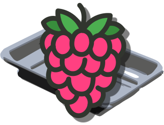

<h1 align="center">Pi-Tray Client</h1>
<p align="center">
    
</p>

---

The touchscreen page shown on the Pi. It connects to the Pi-Tray server on your PC, shows the button grid, sends presses to the server, and shows live buttons as they update.

The easiest way to run it is the [Pi-Tray image](../image), which boots a Pi straight into it. It's a plain web page, so it works anywhere a modern browser runs.

## Connecting

The server's address comes from the `ws` query parameter, e.g. `index.html?ws=ws://192.168.1.50:31415`. Without one, it uses `VITE_DEFAULT_WS_URL` from when it was built (see `.env.template`), or `ws://localhost:31415`.

The first time it connects, it shows a pairing code. Enter it in the editor's **Devices** page. The device's identity is kept in the browser's storage, so it stays paired as long as that storage is kept.

## Building

From the root of the monorepo:

```bash
pnpm install
pnpm --filter @pi-tray/client build
```

The built page is in `apps/client/dist`. It can be opened straight from disk (Chromium needs `--allow-file-access-from-files`) or served over the network.

## Setting up a Pi yourself

If you'd rather not use the image, any Raspberry Pi OS with a desktop works:

1. Copy `dist` onto the Pi, e.g. to `/opt/pi-tray/client`.
2. Optionally create a user just for the screen: `sudo adduser pi-tray`, then `sudo usermod -G video pi-tray`.
3. As that user, create `~/.config/autostart/pi-tray.desktop`, with your PC's address in place of the one here:
    ```ini
    [Desktop Entry]
    Type=Application
    Name=Pi-Tray
    Exec=chromium --kiosk --allow-file-access-from-files "file:///opt/pi-tray/client/index.html?ws=ws://192.168.1.50:31415"
    Terminal=false
    ```
4. Optionally log that user in automatically: in `/etc/lightdm/lightdm.conf`, under `[Seat:*]`, set `autologin-user=pi-tray`.

When the Pi next boots, Pi-Tray opens full screen.

## Development

```bash
pnpm --filter @pi-tray/client dev
```

Then open the address Vite prints, adding `?ws=` if your server isn't on `ws://localhost:31415`.
